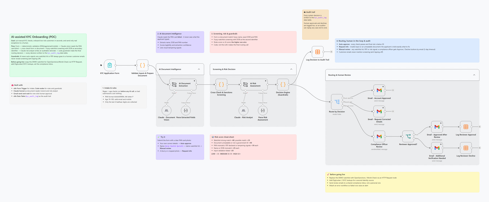

# AI KYC Onboarding – n8n workflow

An n8n workflow that automates KYC (Know Your Customer) onboarding for an Indian bank. It handles intake, AI document reading, sanctions screening and risk scoring, and sends only real exceptions to a human reviewer.

## What it does

1. **Intake & rules.** An n8n form collects applicant details and a PAN card photo. Code checks the PAN format, age, email and mobile number before any AI call.
2. **AI document intelligence.** Claude reads the PAN card *blind*: it never sees what the applicant typed. It extracts the name, date of birth and PAN number, and flags low legibility or signs of tampering.
3. **Screening, risk & guardrails.** The workflow cross-checks the form against the document, screens the name against a watchlist (using date of birth as a second identifier) and computes a rule-based risk score. A second Claude call writes a rationale an auditor can follow. Plain code, not the LLM, makes the final routing decision, and the higher of the two scores wins.
4. **Routing, human-in-the-loop & audit.**
   - **Auto-approve:** every check passes and the final risk score is below 30.
   - **Request info:** the input is invalid or the document is unreadable. The applicant is told exactly what to fix.
   - **Manual review:** any watchlist hit, PEP or other risk signal. A compliance officer gets Approve / Decline buttons by email, with a 2-day timeout.
   - Every system and human decision is written to the `kyc_audit_log` data table.

**Guardrails:** the AI never auto-rejects, any watchlist hit or PEP always goes to a human, and customer emails never mention screening (anti tipping-off).

## Built with

- n8n Form Trigger and Code nodes
- Claude Sonnet (vision and risk analyst) via the Anthropic chat model node
- Gmail (send and send-and-wait for approval)
- n8n Data Table as the audit log

## Import it

1. In n8n, open **Workflows → Import from file** and choose [`workflow/ai-kyc-onboarding.json`](workflow/ai-kyc-onboarding.json).
2. Create a data table named `kyc_audit_log` with these columns: `application_id`, `event_type`, `applicant_name`, `email`, `decision`, `risk_level`, `risk_score` (number), `flags`, `rationale`, `actor`, `straight_through` (boolean), `processing_ms` (number). Select it in the three **Log …** nodes, replacing `YOUR_DATA_TABLE_ID`.
3. Attach your own **Anthropic** and **Gmail** credentials to the Claude and Gmail nodes.
4. In **Compliance Officer Review**, replace `compliance@example.com` with your compliance inbox. In the two **Log Reviewer …** nodes, replace `reviewer@example.com` with the reviewer's identity.

> This export has been sanitised: credential IDs, webhook IDs, the data table ID, the n8n instance ID and personal email addresses have been removed or replaced with placeholders.

## Try it

- Submit with your own correct details → **Auto-approve**
- Use the name `Imran Rashid Qureshi` (a fictional entry on the demo watchlist) → **Manual review**
- Upload a blurry or cropped photo → **Request info**

## Before going live

This is a proof of concept.

- Replace the built-in **DEMO** watchlist with OpenSanctions, World-Check or a similar provider via an HTTP Request node.
- Add DigiLocker / CKYC lookups.
- Send review emails to a shared compliance inbox.
- Attach an error workflow so failed runs raise an alert.
